<p align="center">
  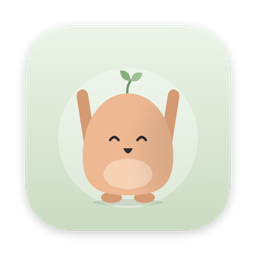
</p>

<h1 align="center">Unknot</h1>

<p align="center">
  Stretch breaks for your Mac that drop out of the camera notch.
</p>

<p align="center">
  <a href="https://github.com/Emsurenar/unknot/releases/latest"></a>
  <a href="https://github.com/Emsurenar/unknot/actions/workflows/build.yml"></a>
  
  <a href="LICENSE"></a>
</p>

<p align="center">
  <a href="https://github.com/Emsurenar/unknot/releases/latest"><strong>Download for macOS</strong></a>
  &nbsp;·&nbsp; <a href="https://emsurenar.github.io/unknot/">Website</a>
  &nbsp;·&nbsp; macOS 14 or later &nbsp;·&nbsp; Apple silicon and Intel &nbsp;·&nbsp; Free and open source
</p>

<p align="center">
  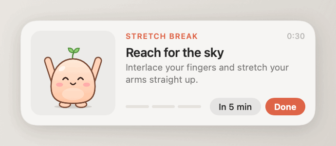
</p>

Every 20 minutes a small panel drops out of the notch at the top of your screen. A member of the Stretch Crew
shows you three quick stretches, a bar fills up, and after 30 seconds the panel goes back where it came from.
It never takes focus, so you can finish your sentence first.

Unknot lives in the menu bar as a small frog. It's a 2 MB download, written in Swift, and has no account,
no tracking and no ads.

## Install

Paste this into Terminal. It downloads the latest release into Applications and opens it:

```bash
curl -fsSL https://raw.githubusercontent.com/Emsurenar/unknot/main/install.sh | bash
```

Or download it yourself:

1. Download `Unknot.zip` from the [latest release](https://github.com/Emsurenar/unknot/releases/latest), unzip it
   and drag **Unknot** into **Applications**.
2. Open it. macOS will say it can't verify the developer, because Unknot isn't signed with a paid Apple
   Developer ID. Click **Done**, go to **System Settings → Privacy & Security**, scroll down and click
   **Open Anyway**. You only do this once.

A welcome window lets you pick how often you want a break and whether Unknot should open at login. After that
the frog in the menu bar points the way.

<p align="center">
  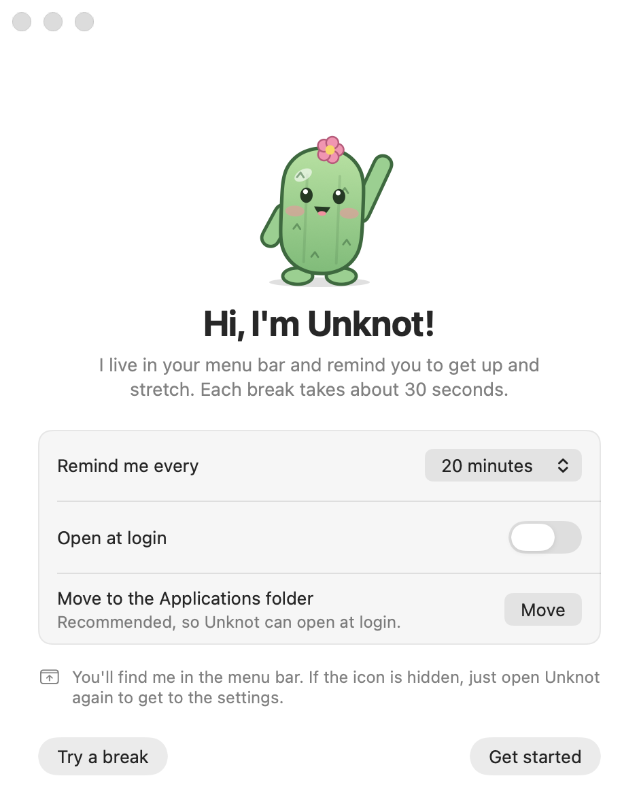
</p>

## A break

<p align="center">
  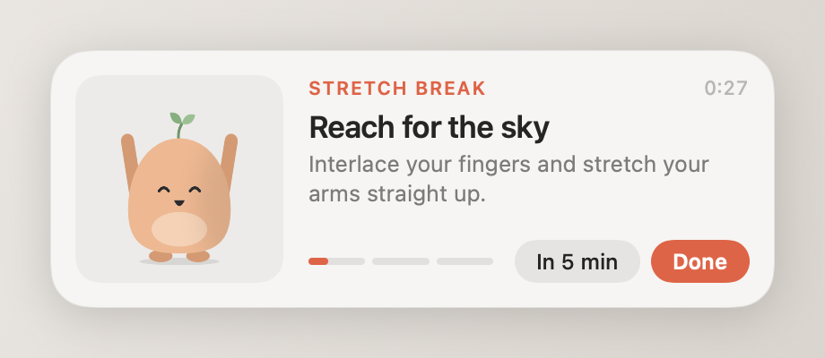
  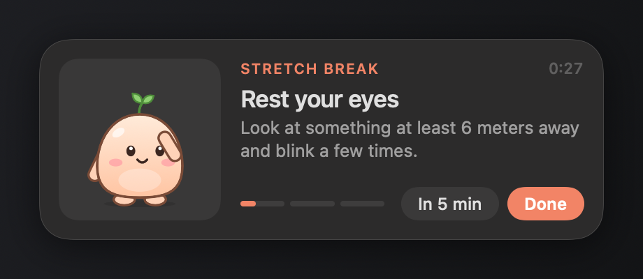
</p>

Each break picks a few exercises from the ones you've switched on, each for a different part of the body and
none from the break before, and the crew does each one the way you should: fingers laced above the head and up on the toes, a bend at the waist with one arm over the
top, a hand resting on the far ear while the head leans, hands on the opposite shoulders for the back hug,
heels rising while the feet stay put. Small motion lines show where the shoulders roll and the wrists turn.
Where timing matters, the label at the top keeps time with it: *Breathe in · 3*, *Switch sides*.

| | Exercise | What you do |
| --- | --- | --- |
| **Neck and shoulders** | Neck stretch | Slowly tilt your ear toward your shoulder, right then left |
| | Shoulder rolls | Roll your shoulders backwards in big, slow circles |
| | Shoulder shrugs | Shoulders up to your ears, hold, let them drop |
| | Shoulder stretch | Pull one arm across your chest, switch halfway |
| **Back and chest** | Reach for the sky | Interlace your fingers and stretch your arms straight up |
| | Side bend | One arm overhead, lean to the side, switch halfway |
| | Seated twist | Twist your upper body with one hand on the chair back |
| | Open your chest | Arms out and back, squeeze your shoulder blades |
| | Back hug | Hug yourself and breathe into your back |
| **Arms, hands and legs** | Wrist circles | Roll your wrists slowly in both directions |
| | Shake it out | Shake out your arms and hands |
| | Calf raises | Stand up, rise onto your toes and back down |
| **Eyes and breathing** | Rest your eyes | Look at something at least 6 meters away and blink |
| | Deep breaths | In for four seconds, out for four, shoulders down |

**Done** ends the break early and counts it. **In 5 min** puts it off for a while.

## The Stretch Crew

<p align="center">
  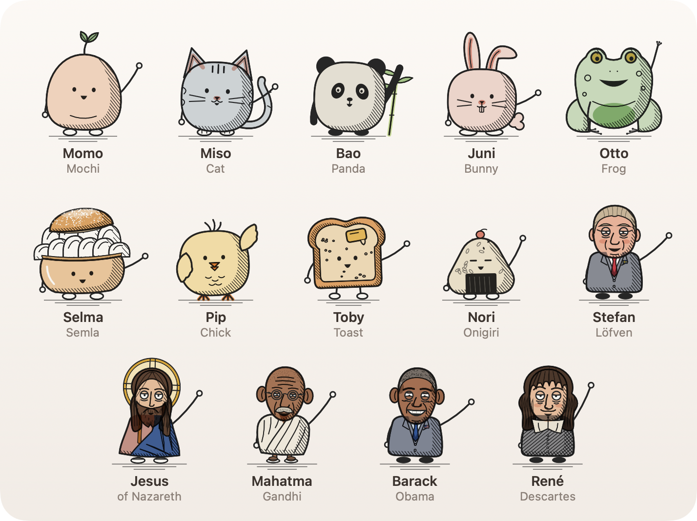
</p>

Fifteen characters drawn like small engravings: one ink line, hatching for shadow and a soft wash of colour.
Otto the frog is on the app icon, Selma is a semla, the Swedish cream bun, Finn is a Finn Crisp, a rye thin full of
fine pores and Kaknäs is Stockholm's TV tower, dishes and all. Stefan Löfven, Jesus, Gandhi, Descartes and
Alexander Bard are drawn from photographs and portraits, in a slightly more cartoonish style: Jesus after the
Sinai icon, Gandhi in his round glasses, Descartes as Frans Hals painted him and Bard with his beard and
polka-dot braces. A random member leads each break,
except on Shrove Tuesday, when Selma leads them all. Under **Settings → Stretch Crew** you can keep only
your favourites.

## When breaks happen

Unknot tries not to interrupt at the wrong moment:

- Time away from the computer counts as a break. Come back after five minutes away and the countdown starts over.
- Sleep and a locked screen also restart the countdown.
- A break that's due waits while you're on a call, meaning another app is using the microphone or camera.
  Unknot only checks whether they're on, never what they hear or see.
- It can wait while an app is in full screen, for presentations and movies (off by default).
- You can limit reminders to working hours, with or without weekends.

The menu bar frog tells you what's going on. Click it to see when the next break is, stretch right away, or
pause for 30 minutes, an hour, two hours or the rest of the day. It closes its eyes while reminders are paused.

<p align="center">
  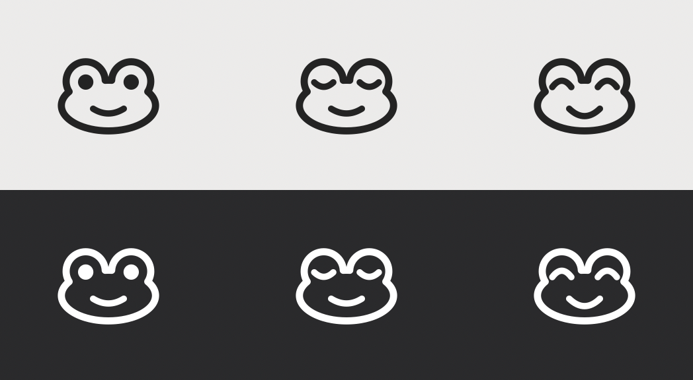
</p>

## Settings

| General | Stretch Crew |
| --- | --- |
| 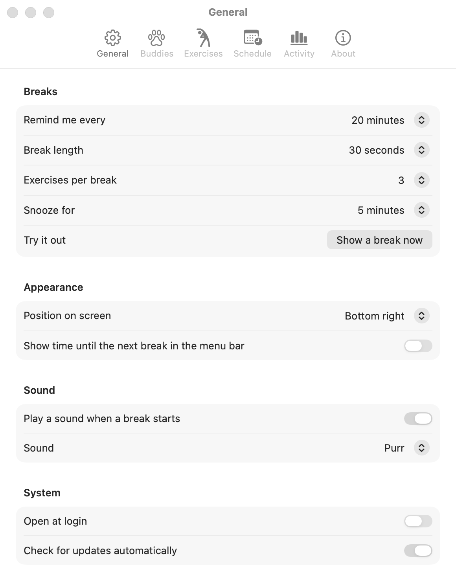 | 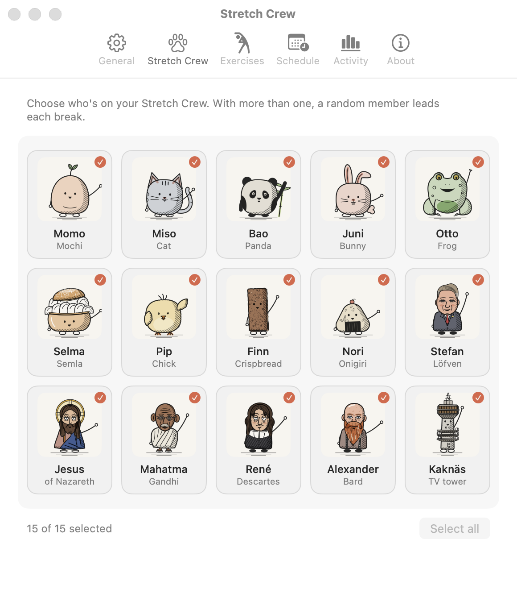 |

| Exercises | Activity |
| --- | --- |
| 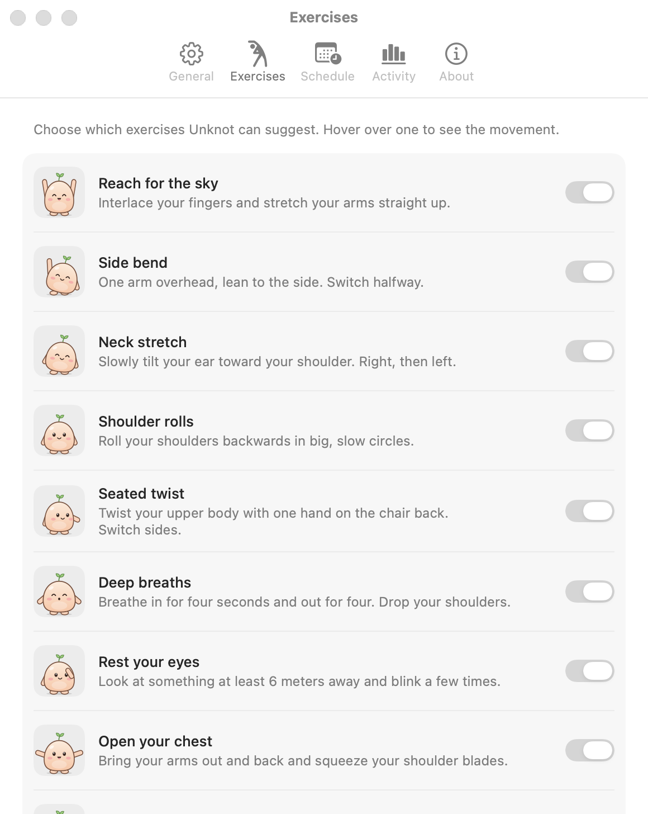 | 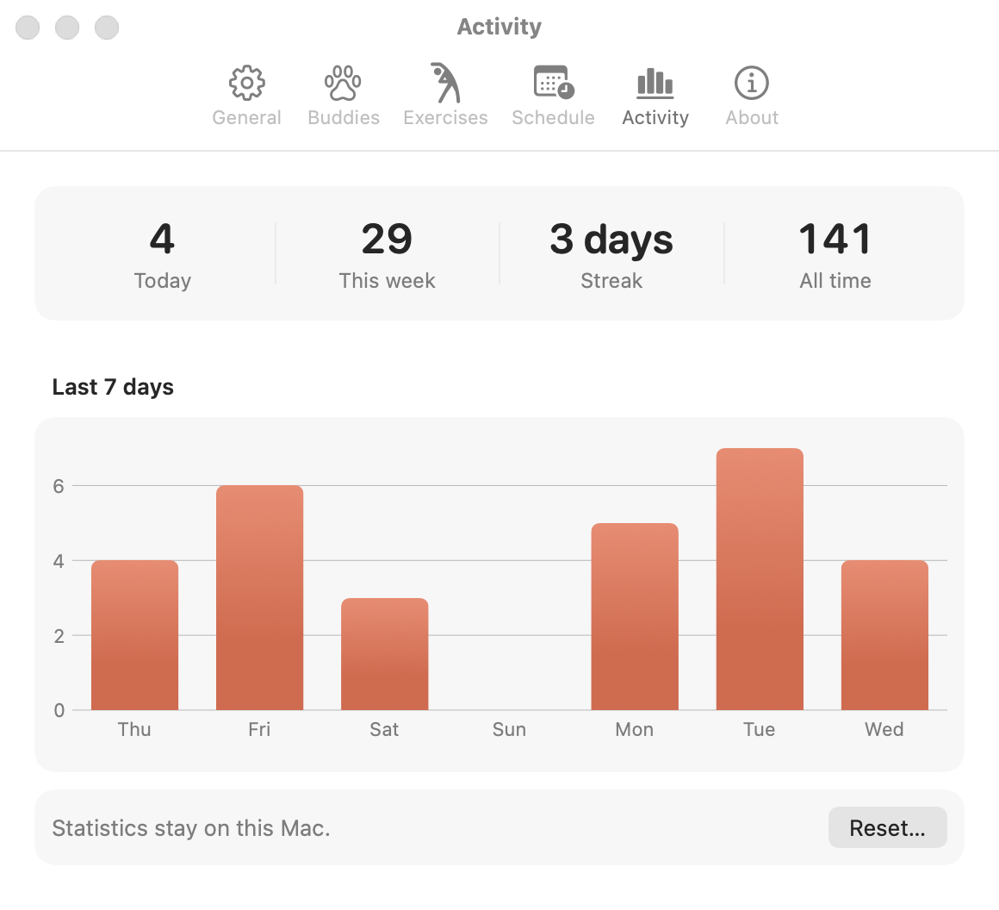 |

Settings are under the menu bar frog, or open Unknot again from Finder or Spotlight. Besides the interval
you can change the length of a break, the number of exercises, the snooze time, where the panel appears
(top center or one of the corners, picked on a little map of the screen), the sound and the language
(English or Swedish). **Activity** shows your breaks today, this week, your streak and a chart of the last
seven days.

## Privacy

Unknot doesn't collect anything. Settings and statistics stay on your Mac. The only network request is an
optional check of GitHub's releases API, at most once a day, to see if there's a new version. If there is and
you click **Install and Restart**, Unknot downloads it from this repository's releases, checks its SHA-256
checksum and replaces itself. You can turn the check off under **Settings → General**. [SECURITY.md](SECURITY.md)
has the details, and how to report a security issue.

## Questions

**The menu bar icon is missing.** On a MacBook with a notch, icons that don't fit are hidden behind it.
Open Unknot again from Finder or Spotlight to get to the settings, or quit a few other menu bar apps.

**My Mac has no notch.** The panel drops down from under the menu bar instead. The same goes for external
displays.

**Can I move the panel?** Pick a corner under **Settings → General → Position on screen**.

**How do I update?** Unknot tells you in the menu when a new version is out, and installs it with one click.
Running the install command again works too.

**How do I uninstall it?** This removes the app, its login item, settings and statistics:

```bash
curl -fsSL https://raw.githubusercontent.com/Emsurenar/unknot/main/install.sh | bash -s -- --uninstall
```

Or by hand: turn off **Open at login** under Settings, choose **Quit Unknot** in the menu, drag the app to the
Trash and run `defaults delete io.github.emsurenar.unknot`.

## Build from source

You need the Xcode Command Line Tools (`xcode-select --install`). There are no dependencies and no Xcode
project.

```bash
git clone https://github.com/Emsurenar/unknot.git
cd unknot
./build.sh && open build/Unknot.app
```

[CONTRIBUTING.md](CONTRIBUTING.md) explains how the code is laid out, how to add a crew member or a
translation, and how releases are made. Bug reports and ideas are welcome in
[Issues](https://github.com/Emsurenar/unknot/issues).

## License

[MIT](LICENSE) © 2026 Emre Sunar
